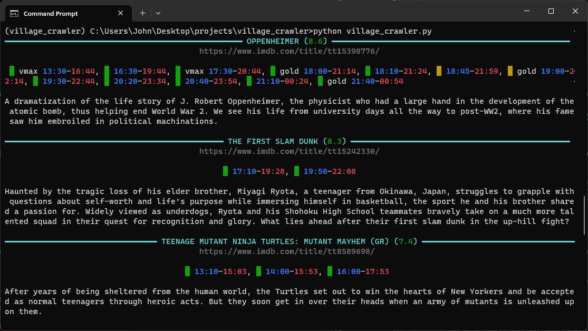

# Village Crawler

Reverse-engineered Village Cinemas (Greece) scraper that retrieves currently
playing movies with showtimes, ticket availability, and IMDB ratings — then
presents everything in a colourful, sorted terminal view.

<p align="center">
  
</p>

## Features

- Scrapes the Village Cinemas WebTicketing API for live showtimes & availability
- Enriches each movie with its IMDB rating (multi-threaded, Greek titles transliterated)
- Sorts movies by IMDB rating (highest first)
- Interactive cinema picker or pass the menu number via CLI
- Smart JSON cache (auto-expires after 12 hours or when dates go stale)
- Tags for Dolby, Sphera, VMax, IMAX, 3D, Gold screens
- Ticket price next to each showtime, fetched from the Village site (Wednesday discount applied)

## Installation

Clone the repository:

```bash
git clone https://github.com/johneliades/village_crawler.git
cd village_crawler
```

Create a virtual environment and install dependencies:

**Windows**
```
python -m venv .venv && .venv\Scripts\activate && pip install -r requirements.txt
```

**Linux / macOS**
```
python -m venv .venv && source .venv/bin/activate && pip install -r requirements.txt
```

## Usage

Activate the virtual environment first, then:

```bash
# Interactive cinema picker, today's showtimes
python village_crawler.py

# Specify a cinema by menu number or part of its name
python village_crawler.py -c 1
python village_crawler.py -c maroussi

# Specific date (DD/MM)
python village_crawler.py -d 25/06

# Date + only show screenings after a given time
python village_crawler.py -d 25/06 -t 20:00

# Force fresh data (ignore cache)
python village_crawler.py --no-cache

# Clear cache and re-fetch
python village_crawler.py --clear

# List cinemas with their menu numbers
python village_crawler.py --list
```

### Cinemas

| # | Cinema                              |
|---|-------------------------------------|
| 1 | Maroussi – The Mall Athens          |
| 2 | Rentis – Village Shopping and more… |
| 3 | Thessaloniki – Mediterranean Cosmos |
| 4 | Agios Dimitrios – Athens Metro Mall |
| 5 | Pagrati – Pagrati Village           |
| 6 | Volos – Volos Village               |
| 7 | Larissa – Fashion City Outlet       |


## Project layout

```
village_crawler.py      Entry point: CLI arguments, cinema picker, main()
crawler/
├── village.py          Cinema list and showtime scraper for the Village site
├── prices.py           Ticket prices from the Village site, price per showtime
├── imdb_lookup.py      IMDB search (incl. Greek title transliteration), ratings
├── cache.py            JSON cache of crawled movies (stored in .cache/)
├── display.py          Prints the movie list (showtimes, tags, prices, plots)
└── terminal.py         ANSI colours and centring helpers
```

## Cache

Scraped data is cached as JSON under a `.cache/` directory (auto-created).  
The cache expires automatically after **12 hours** or when all showtime dates
are in the past. Use `--no-cache` to skip the cache or `--clear` to delete it.
